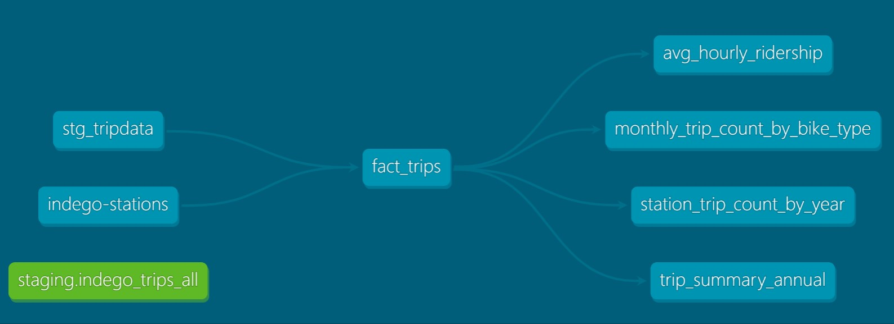
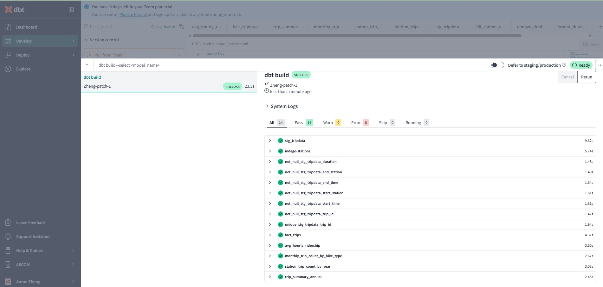
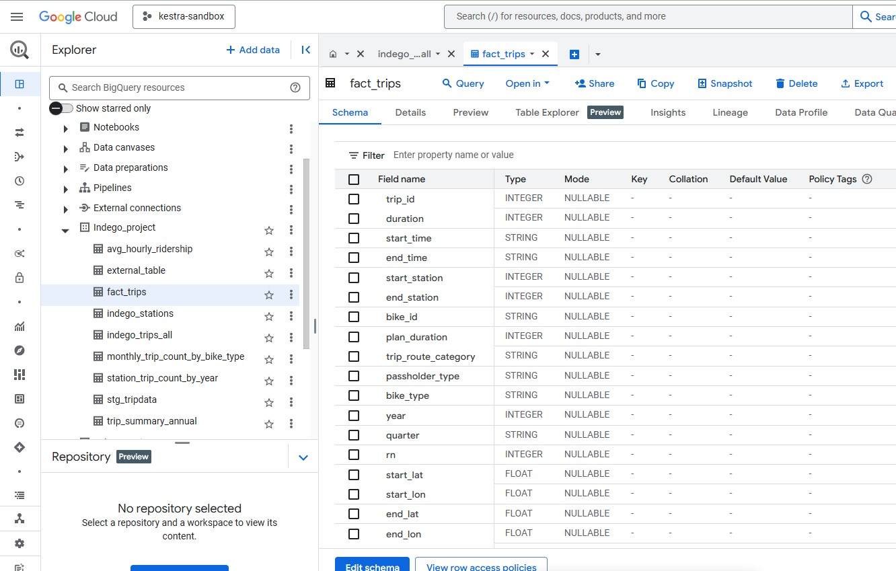

# Step 3: Data Transformation

After transforming and loading the data into BigQuery with Airflow, we use Data Build Tool (DBT) to join the dimension tables with the fact tables. This process generates specific reporting tables in another schema within BigQuery. These reporting tables are optimized for querying and analysis, providing insights into various aspects of the data.

**1.Set up DBT with Bigquery:**

[Instructions](https://github.com/ManuelGuerra1987/data-engineering-zoomcamp-notes/blob/main/4_Analytics-Engineering/README.md)

- Create a BigQuery service account and new key
- Create a dbt cloud project and connect with Github repository [Video source](https://www.youtube.com/watch?v=J0XCDyKiU64)
- Set up the development environment [Video source](https://www.youtube.com/watch?v=V2m5C0n8Gro)

**2.Run the DBT model:**

Here is the lineage graph for DBT. The goal is to transform raw data, `Indego_trips_all` and `indego_stations` into a series of aggregated tables for further dashboard visualization. 

Model overview:
- [stg_tripdata](https://github.com/Anran0716/DE-Project-Bikeshare/blob/main/DBT/models/staging/stg_tripdata.sql): This staging model cleaned raw trip data from `indego_trips_all` table.
- [fact_trips](https://github.com/Anran0716/DE-Project-Bikeshare/blob/main/DBT/models/core/fact_trips.sql): This is a fact table, including a detailed records of trips and bike station information.
- [avg_hourly_ridership](https://github.com/Anran0716/DE-Project-Bikeshare/blob/main/DBT/models/core/avg_hourly_ridership.sql): This model calculates the average number of trips taken at each hour of the day.
- [monthly_trip_count_by_bike_type](https://github.com/Anran0716/DE-Project-Bikeshare/blob/main/DBT/models/core/monthly_trip_count_by_bike_type.sql): This model tracks monthly trends in bike usage based on different bike types.
- [station_trip_count_by_year](https://github.com/Anran0716/DE-Project-Bikeshare/blob/main/DBT/models/core/station_trip_count_by_year.sql): This model calculates the annually number of trips starting and ending at each station. 
- [trip_summary_annual](https://github.com/Anran0716/DE-Project-Bikeshare/blob/main/DBT/models/core/trip_summary_annual.sql): Provides a comprehensive annual summary of bike share usage with key performance metrics.

To run the DBT model: 
- Revise the name of `database` with your project name in [schema.yml](https://github.com/Anran0716/DE-Project-Bikeshare/blob/main/DBT/models/staging/schema.yml) and [stg_tripdata.sql](https://github.com/Anran0716/DE-Project-Bikeshare/blob/main/DBT/models/staging/stg_tripdata.sql)
- Run `dbt build`
- If you want to check single model, using `dbt compile` and `dbt run --select {model_name}`

The station lookup is committed as [`seeds/indego_stations.csv`](seeds/indego_stations.csv),
so a clone includes the data needed by `ref('indego_stations')`. It contains 304 station
records from the [public Indego station CSV](https://www.rideindego.com/wp-content/uploads/2025/01/indego-stations-2025-01-01.csv)
used by the ingestion pipeline. Headers use snake_case, and the station ID has an
explicit `INT64` seed type. `dbt build` loads this seed and tests station IDs for
uniqueness and missing values. If replacing a seed already loaded with the old
headers, run `dbt seed --full-refresh --select indego_stations` before `dbt build`.

`stg_tripdata` handles deduplication, coordinate filling, and timestamp parsing.
It parses raw `start_time` and `end_time` strings once into `start_ts` and `end_ts`
with `SAFE.PARSE_TIMESTAMP('%m/%d/%Y %H:%M', ...)`. Malformed strings are retained
as `NULL` timestamps and fail the corresponding `not_null` tests; they are not
filtered out. Parsing preserves the previous default UTC convention and does not
convert the source's local wall-clock times to America/New_York instants.

The staging model no longer creates display labels or formatted durations.
Hourly and monthly reports derive their labels directly from `start_ts`.
The existing `core` layout and wide `fact_trips` are retained for this first step;
station/date dimensions and the move of reports into `marts` are subsequent work.

After successfully running these models, in your Bigquery project, you should see a few table being created. 

